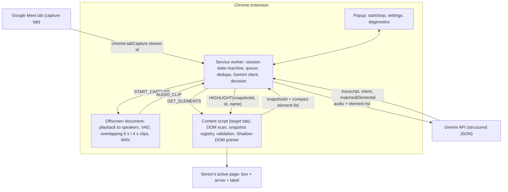

# Senior Helper Pointer

A Chrome extension (Manifest V3) that helps an older adult find things on a web page while a family member guides them over **Google Meet**. When the family member says *"Mom, click the Compose button on the left"*, a large pointer appears on that button on Mom's screen.

- Works on ordinary websites (Gmail, Meet, Wikipedia, shops, news…), subject to Chrome's restrictions.
- **Never clicks, types or submits anything.** It only points.
- Near-zero cost: no backend, no database. Typed commands work offline with no API key. Voice uses your own Gemini API key (free tier available).
- The family member installs nothing.

## Project status

| Area | Status |
|---|---|
| Typed commands (offline matcher), pointer, DOM scanning | ✅ Verified in real Chrome, including live Wikipedia and example.com |
| Snapshot validation, privacy filters, no-click guarantee | ✅ Verified in real Chrome (integration tests) |
| Voice pipeline logic (dedupe, stale results, rate limits) | ✅ Verified in real Chrome with a **mocked** Gemini |
| Meet tab audio capture + real Gemini audio understanding | ⚠️ **Not yet verified in a real call.** See [docs/TESTING.md](docs/TESTING.md) |
| Speech-to-pointer latency | ⚠️ Not measured yet. Recorded live in popup → Diagnostics |

## Quick start (2 minutes, no API key)

1. Open `chrome://extensions`, turn on **Developer mode**, click **Load unpacked**, and select this folder.
2. Open <https://en.wikipedia.org> and click the extension icon.
3. Type `where is log in` and press **Highlight Element**. A magenta pointer appears on "Log in".

For voice, add a Gemini API key (see [Install](#install)) and follow [Use → Live call](#use).

## Architecture



**Capture tab vs. target tab.** Audio always comes from the Meet tab where you pressed *Start Listening*. The pointer goes on whatever normal tab is active in the last focused window. Switching tabs never touches the capture.

**Flow for one spoken command:**
1. The offscreen document plays the Meet audio back (capture mutes the tab otherwise) and runs an energy-based VAD with an adaptive noise floor.
2. A clip is sent **~0.7 s after speech ends**, or every **4 s** during long speech. Each clip holds up to **6 s** of audio, so consecutive clips overlap by 2 s and a sentence crossing a boundary is heard whole. Silence is never sent.
3. The service worker drops stale work (old session, already-handled sequence, older than 15 s, rate-limited), asks the content script for a fresh **snapshot**, and sends the clip plus a compact element table (`[id, role, name, region, visible]`) to Gemini with a strict response schema.
4. The answer is validated: unknown ids and unsupported intents are rejected, and confidence is clamped. Then it is combined with the deterministic matcher:
   - A confident validated pick points directly.
   - A missing or low-confidence pick falls back to matching the spoken target locally.
   - If it is still ambiguous, up to 3 numbered candidates are shown instead of guessing.
5. Duplicate commands from overlapping clips are suppressed (same target and element within 10 s). Results that arrive after *Stop* or after a newer highlight are discarded.
6. The content script resolves `(snapshotId, id)` to the live element and checks it still exists, is visible, and still has the same accessible name. If the page re-rendered, it re-matches by role and name. Only then does it draw the pointer.

**Typed commands** (popup) use the same path, except the offline matcher is tried first and Gemini (text) is only asked if the matcher is unsure and a key is saved.

**Session states:** `idle → starting → listening ⇄ processing → interrupted / error → idle`. Every Start or Stop bumps a *generation* number, so work started under an older session is discarded.

## Project layout

```
manifest.json
src/
  background/          service worker (type: module)
    index.js             message routing + sender validation, tab listeners, SW recovery
    capture.js           start/stop/interrupt capture, offscreen lifecycle, action badge
    pipeline.js          clip/text -> snapshot -> Gemini/matcher -> validated highlight
    decision.js          combine Gemini answer with matcher; ambiguity handling (pure)
    matcher.js           offline matcher: names, synonyms, roles, position (pure)
    gemini.js            REST client: schema, timeout, model fallback, retries (fetch injectable)
    prompt.js            system prompt, schema, compact elements, response validation (pure)
    sessionState.js      state machine, stale checks, dedupe (pure)
    session.js           chrome.storage.session wrapper with a write lock
    metrics.js           latency/usage aggregation (pure)
    queue.js             in-order queue that keeps only the newest waiting job
    tabs.js              top-frame messaging, auto-injection, target-tab lookup
  offscreen/           audio capture document
    offscreen.js         tab stream -> playback + analysis branch -> clips / live stream
    segmenter.js         EnergyVad + ClipSegmenter (pure)
    audio.js             streaming resampler, WAV/PCM encoding (pure)
  content/             top frame of http(s) pages
    loader.js            classic script that imports main.js once
    main.js              message handling
    elements.js          DOM scan incl. open shadow roots + same-origin iframes
    accname.js           role + accessible name (never reads field values)
    describe.js          region, normalization, candidate limiting (pure)
    snapshot.js          snapshot registry with WeakRefs (pure)
    validate.js          snapshot validation + re-matching
    pointer.js           box + arrow + label, follows layout, auto-expires
    badge.js             status badge + "listening" pill with Stop button
    overlay.js / styles.js  closed Shadow-DOM overlay host + CSS
  voice/               experimental Gemini Live streaming client (not the default)
  popup/               start/stop, test command, settings, diagnostics
  shared/              constants, message names, URL helpers
test/                  unit tests (node:test)
test/integration/      real-Chrome tests (Puppeteer + Chrome for Testing)
test/fixtures/         local test page (shadow DOM, iframe, privacy traps)
docs/TESTING.md        manual end-to-end procedure for a real Meet call
```

Modules marked *pure* have no Chrome or DOM dependencies and are unit tested in Node.

## Install

1. Open `chrome://extensions` and turn on **Developer mode**.
2. Click **Load unpacked** and select this folder (the one containing `manifest.json`). Chrome 116 or later is required.
3. Pin the extension. Open its popup, then **Settings**, and paste a Gemini API key from <https://aistudio.google.com> (only needed for voice). Click **Save Settings**.

After pulling new code, click the **reload** icon on the extension card in `chrome://extensions`, then reload any open tabs.

## Use

- **Test without voice or a key:** open Gmail or Wikipedia, open the popup, type `click the compose button` or `where is log in`, and press **Highlight Element** (or Enter).
- **Live call:**
  1. Mom joins the Meet call and shares her window or screen.
  2. On the **Meet tab**, she opens the popup and presses **Start Listening**. The toolbar badge shows **ON** and pages show a red *"Helper is listening [Stop]"* pill.
  3. She switches to Gmail (or any page). Capture continues.
  4. The family member says *"click the Compose button"*. The pointer appears for about 20 seconds.
  5. Stop at any time with the pill's **Stop** button or the popup.

**Example phrases that work:** "click Compose", "where is the mic button", "hang up the call", "the record button on the right", "click in the search box", "where is log in". If two controls fit equally, numbered choices appear so the family member can clarify.

## Configuration

**Popup → Settings**

| Setting | Default | Notes |
|---|---|---|
| Gemini API key | – | Required for voice only |
| Model | `gemini-flash-latest` | Google's alias for the current Flash model. If the model is not found, an available Flash model is chosen automatically and saved here |
| Voice mode | Audio clips | *Gemini Live streaming* is experimental |
| Live model | see `constants.js` | Only used in Live mode |

**Tuning constants** in [src/shared/constants.js](src/shared/constants.js):

| Constant | Default | Effect |
|---|---|---|
| `END_OF_SPEECH_MS` | 700 | Silence that ends an utterance. Lower means faster but may cut sentences |
| `CLIP_WINDOW_MS` / `CLIP_HOP_MS` | 6000 / 4000 | Clip length and interval during long speech (2 s overlap) |
| `MIN_SPEECH_MS` | 250 | Shorter sounds (coughs, clicks) are not sent |
| `MAX_CLIP_AGE_MS` | 15000 | Older clips are dropped as stale |
| `DEDUPE_WINDOW_MS` | 10000 | The same command within this window is ignored |
| `GEMINI_TIMEOUT_MS` | 15000 | Per-request timeout |
| `MAX_ELEMENTS` / `MAX_SAME_NAME` | 180 / 4 | Prompt size limits |
| `HIGHLIGHT_TIMEOUT_MS` | 20000 | Pointer lifetime |

## Tests

```
npm install                # dev only: Puppeteer + Chrome for Testing
npm test                   # 90 unit tests (Node 20+)
npm run test:integration   # 27 tests that load the real extension in Chrome for Testing
npm run test:all           # both
```

| Suite | Covers |
|---|---|
| Unit (`test/*.test.js`) | Audio encoding/resampling, VAD and overlapping clips, prompt/schema, response validation, Gemini client (404 fallback, 429, 5xx, timeout), matcher and synonyms, decision/ambiguity, session state machine, stale/dedupe, metrics, snapshot registry, URL filter, Live protocol |
| Integration (`test/integration/`) | Injection, shadow DOM, iframe coordinates, privacy (no field values sent), snapshot validation, pointer tracking, zero clicks, re-injection, popup, restricted pages, voice pipeline with mocked Gemini, real Wikipedia and example.com |
| Manual ([docs/TESTING.md](docs/TESTING.md)) | Real Meet call: capture, playback, tab switching, Gmail/Meet controls, latency |

The integration suite needs network access for the real-site tests (they are skipped if a site is unreachable). Set `SCREENSHOT_DIR` to choose where screenshots are written (default `test/integration/screenshots/`, git-ignored).

## Development

- **Add a synonym:** extend `SYNONYMS` in `src/background/matcher.js` and add a case to `test/matcher.test.js`.
- **Debug the service worker:** `chrome://extensions` → *Service worker* → Console. **Offscreen document:** *Inspect views: offscreen.html* (only present while listening).
- **Message rules:** message names live in `src/shared/messages.js`. Content scripts may only send `STOP_LISTENING`, and audio messages are only accepted from the offscreen document.
- **No build step:** plain ES modules. Content scripts load through `loader.js` → dynamic `import()`, which is why `src/content/*.js` and `src/shared/*.js` are web-accessible.

## Privacy and security

- Capture starts only when you press **Start Listening**. A badge and an on-page pill show it is active, and Stop is one click away.
- While listening, **short clips of the Meet tab's audio** and the **names/roles of visible buttons and links** on your current page are sent to Google's Gemini API. They are subject to your API tier's data-use terms (free-tier data may be used by Google to improve products).
- Never sent: page HTML, field values, passwords, typed text, message bodies, cookies. Labels are truncated to 60 characters. Note that link text (for example an email subject shown as a link) can appear among the labels.
- No audio or transcripts are written to disk. The last transcript is kept only in memory (`chrome.storage.session`) for context and is cleared on Stop.
- Page text is treated as untrusted data: it is JSON-encoded in the prompt, the model's output is schema-validated, and returned ids must be in the submitted list. Nothing the model returns is executed or used as a selector.
- Web pages cannot drive the extension: messages are checked by sender type, and content scripts may only send *Stop*.
- **API key:** stored in `chrome.storage.local`. That is **not** a secure vault. Use your own key. Never publish a build that contains a key. Public distribution would need a small token-issuing backend.
- `web_accessible_resources` exposes the content-script modules (needed to load ES modules), so a web page can detect that the extension is installed.

## Troubleshooting

| Symptom | What to check |
|---|---|
| **Meet audio not captured** | Press **Start Listening** from the popup *while the Meet tab is active* (Chrome requires the extension to be invoked on that tab). Look at the popup state line. `chrome://extensions` → *Service worker* → Console shows errors. A tab already captured by another extension cannot be captured twice. |
| **Meet audio becomes silent** | The offscreen document plays the audio back. Open `chrome://extensions` → *Inspect views: offscreen.html* → Console. Press Stop and Start again. If the Meet tab was reloaded, capture ends (state: *interrupted*). |
| **Gemini errors** | The popup state shows the message. `API key rejected` means re-paste the key. `Rate limit` means the helper pauses automatically. `Model not found` means it auto-switches to an available Flash model (saved in Settings), or you can enter a model manually. |
| **No matching element** | Use the popup test box to check the page has a control with that label. Icon-only buttons need an `aria-label`/`title`. Cross-origin iframes and canvas-drawn controls are not supported. |
| **Not running on a page** | Content scripts don't run on `chrome://`, the Chrome Web Store, the PDF viewer or `file://` pages. Tabs opened before installing are injected automatically on first use. |
| **Service worker / offscreen errors** | `chrome://extensions` → reload the extension. After a service-worker restart, the session is reconciled: if the offscreen document is gone, the state becomes *interrupted*. |
| **Pointer on the wrong tab** | The pointer goes to the active tab of the *last focused* Chrome window. Click into the window Mom is looking at. |
| **Popup diagnostics** | *Diagnostics* shows the last transcript, median Gemini / match / speech-to-pointer latency, API calls per minute and error rate. |

## Known limitations

- Voice has not yet been validated in a real Meet call (see docs/TESTING.md). Speech-to-pointer latency is expected to be roughly 0.7 s (end of speech) + upload + Gemini time; measure it with Diagnostics.
- Captured audio is the whole Meet tab playback, including the senior's own voice if Meet echoes it, and any shared media. Gemini decides what is an instruction.
- Cross-origin iframes, closed shadow roots, canvas UIs and native browser dialogs are not scanned.
- Elements in the browser's top layer (`<dialog>.showModal()`, fullscreen) can cover the overlay.
- `ScriptProcessorNode` is deprecated but still supported. An AudioWorklet port is a possible future improvement.
- The experimental *Gemini Live* mode (`src/voice/`) depends on a Live model name that changes often.

## Roadmap

1. Run the real-call procedure and record accuracy and latency (target: ≥ 90% correct on 20–30 commands, zero unintended clicks).
2. Tune `END_OF_SPEECH_MS`, or switch to streaming transcription if latency is too high.
3. Support cross-origin iframes through per-frame content scripts.
4. Port audio processing to an AudioWorklet.
5. Multilingual commands.
6. Chrome Web Store release with a token-issuing backend instead of a user-supplied key.
