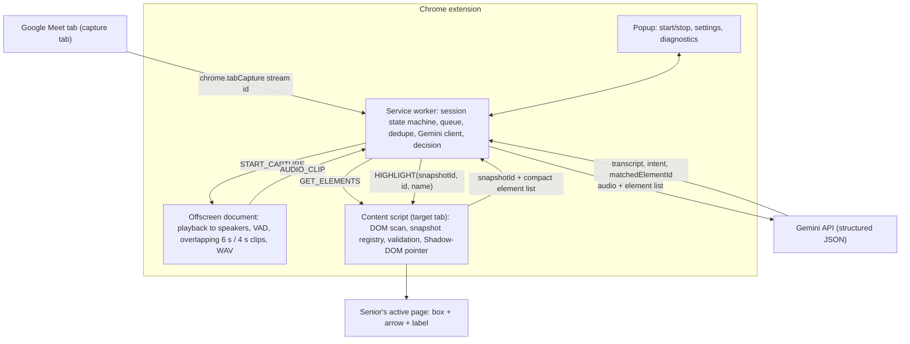

# Senior Helper Pointer

A Chrome extension (Manifest V3) that helps an older adult find things on a web page while a family member guides them over **Google Meet**. When the family member says *"Mom, click the Compose button on the left"*, a large pointer appears on that button on Mom's screen.

- Works on ordinary websites (Gmail, Meet, Wikipedia, shops, news…), subject to Chrome's restrictions.
- **Never clicks, types or submits anything.** It only points.
- Near-zero cost: no backend, no database. Typed commands work offline with no API key. Voice uses your own Gemini API key (free tier available).
- The family member installs nothing.

## Contents

1. [Project status](#project-status)
2. [Install the extension](#1-install-the-extension)
3. [Test the repo (automated tests)](#2-test-the-repo-automated-tests)
4. [Test the app by hand: typed commands, no key](#3-test-the-app-by-hand-typed-commands-no-key)
5. [Test voice in a real Google Meet call](#4-test-voice-in-a-real-google-meet-call)
6. [Development workflow](#development-workflow)
7. [Where is the API key stored?](#where-is-the-api-key-stored)
8. [How it works](#how-it-works) · [Project layout](#project-layout) · [Configuration](#configuration)
9. [Privacy and security](#privacy-and-security) · [Troubleshooting](#troubleshooting) · [Known limitations](#known-limitations) · [Roadmap](#roadmap)

## Project status

| Area | Status |
|---|---|
| Typed commands (offline matcher), pointer, DOM scanning | ✅ Verified in real Chrome, including live Wikipedia and example.com |
| Snapshot validation, privacy filters, no-click guarantee | ✅ Verified in real Chrome (integration tests) |
| Voice pipeline logic (dedupe, stale results, rate limits) | ✅ Verified in real Chrome with a **mocked** Gemini |
| Meet tab audio capture + real Gemini audio understanding | ⚠️ **Not yet verified in a real call.** Section 4 / [docs/TESTING.md](docs/TESTING.md) |
| Speech-to-pointer latency | ⚠️ Not measured yet. Recorded live in popup → Diagnostics |

---

## 1. Install the extension

**You need:** Google Chrome **116 or newer** (`chrome://version`).

1. Get the code:
   ```
   git clone https://github.com/yasamanparhizkar/build-north-2026.git
   cd build-north-2026
   git checkout dev
   ```
   (Or use your existing folder, e.g. `Z:\senior-helper-extension`.)
2. Open `chrome://extensions` and switch on **Developer mode** (top right).
3. Click **Load unpacked** and select the folder that contains `manifest.json`.
4. Click the puzzle icon in the toolbar and pin **Senior Helper Pointer**.
5. *(Voice only)* Get a free key at <https://aistudio.google.com> → *Get API key*. Then open the extension popup → **Settings**, paste the key, and click **Save Settings**.

✅ **Check:** the extension card shows no red *Errors* button, and clicking the icon opens a popup that says **Not listening**.

**After every code change** (or `git pull`), click **↻ reload** on the extension card in `chrome://extensions`, then reload the web pages you test on.

---

## 2. Test the repo (automated tests)

### Prerequisites
- **Node.js 20+** and **Git**. Check with `node --version`.
  - Windows: `winget install OpenJS.NodeJS.LTS` (or the installer from <https://nodejs.org>). Then open a new terminal.
  - If PowerShell says *"running scripts is disabled"* for `npm`, use `npm.cmd` instead of `npm`, or run once: `Set-ExecutionPolicy -Scope CurrentUser RemoteSigned`.

### Steps
```
npm install                # once: dev tools only (Puppeteer). Downloads "Chrome for Testing" (~150 MB)
npm test                   # unit tests incl. manifest check, about 5 s
npm run test:integration   # loads the real extension in Chrome for Testing, about 30-60 s
```
`npm install` puts Chrome for Testing in `%USERPROFILE%\.cache\puppeteer` (macOS/Linux: `~/.cache/puppeteer`). Your normal Chrome profile is not touched.

### Expected output
`npm test` ends with:
```
# tests 92
# pass 92
# fail 0
```
`npm run test:integration` ends with:
```
# tests 28
# pass 28
# fail 0
```
It also prints lines like:
```
#   en.wikipedia.org: 70 elements in 15 ms
#   "where is log in" -> ✅ Pointing to: Click Log in (local) (45 ms end-to-end, offline)
```

- **Network:** the 3 real-site tests (Wikipedia, example.com) need internet. They are *skipped*, not failed, if a site is unreachable.
- **Screenshots** go to `test/integration/screenshots/` (git-ignored). Set the `SCREENSHOT_DIR` environment variable to change this.
- **No API key is needed.** The voice tests replace Gemini with a fake inside the test browser.

### What the suites cover

| Suite | Covers |
|---|---|
| Unit (`test/*.test.js`) | Audio encoding/resampling, voice-activity detection and overlapping clips, prompt and schema, response validation (made-up ids, unsupported actions, malformed JSON), Gemini client (model fallback, 429, 5xx, timeout), matcher and synonyms, ambiguity handling, session state machine, stale-result rejection, dedupe, metrics, snapshot registry, URL filter, Live protocol |
| Integration (`test/integration/`) | Injection, shadow DOM, iframes, privacy (field values never sent), snapshot validation, pointer tracking, **zero clicks**, re-injection, popup and "Forget API key", restricted pages, voice pipeline with mocked Gemini, real Wikipedia and example.com |
| Manual (sections 3–4, [docs/TESTING.md](docs/TESTING.md)) | Real Gmail/Meet pages, real tab audio capture, real Gemini, latency |

---

## 3. Test the app by hand: typed commands, no key

These checks use the popup's **Test a command** box. No API key and no Meet call are needed. Open each page, click the extension icon, type the command, and press **Enter**.

| # | Page | Type | Expected result |
|---|---|---|---|
| 1 | <https://en.wikipedia.org> | `where is log in` | Magenta box + arrow + "👆 Click Log in" on **Log in** (top right). Popup: `✅ Pointing to: Click Log in (local)` |
| 2 | Same | `click in the search box` | Pointer on the **Search Wikipedia** box |
| 3 | Same | `click the print button` | No pointer. Badge: *"I couldn't find "click the print button" on this page."* |
| 4 | Same | (wait 20 s after #1) | The pointer disappears by itself |
| 5 | Same | `where is log in`, then click **Clear Pointer** | The pointer disappears immediately |
| 6 | Same | `where is log in`, then scroll the page | The pointer stays attached to the link |
| 7 | <https://mail.google.com> (signed in) | `click compose` | Pointer on **Compose** (top left) |
| 8 | Gmail | `where is the search box` | Pointer on **Search mail** |
| 9 | Gmail | `click settings` | Pointer on the gear icon (an icon-only button) |
| 10 | <https://meet.google.com> (in a call) | `where is the mic button` | Pointer on the microphone button |
| 11 | `chrome://extensions` | `click compose` | Popup: *"Chrome does not allow the helper on this page"* |

**Safety check:** during all of the above, nothing should ever be clicked, typed or submitted by the extension.

---

## 4. Test voice in a real Google Meet call

**You need:** a saved Gemini API key (section 1, step 5), one **computer** with the extension (the *senior* side) and one **phone or second computer** (the *family member*). The family member side needs nothing installed. Use headphones on the senior computer so the family member's voice isn't picked up twice.

### Quick voice test (about 5 minutes)

1. **Computer:** open <https://meet.google.com>, click **New meeting** → *Start an instant meeting*, and copy the link.
2. **Phone:** join the same meeting with the link (any Google account, or as a guest).
3. **Computer, on the Meet tab:** click the extension icon → **🎧 Start Listening**.
   ✅ Toolbar badge shows red **ON**, popup shows **🎧 Listening**, and a red *"🎧 Helper is listening [Stop]"* pill appears top right.
4. **Phone:** say something. ✅ You still hear it clearly on the computer (no silence, no echo).
5. **Computer:** open a new tab with <https://en.wikipedia.org> (or Gmail) and stay on it.
6. **Phone:** say clearly: *"Click the Log in button."* (on Gmail: *"Click the Compose button."*)
   ✅ Within a few seconds the pointer appears on that control.
7. **Phone:** chat normally for 30 s (*"How was your day?"*). ✅ No pointer appears.
8. **Phone:** say *"Click the print button."* ✅ Badge: *"I couldn't find…"*, no pointer.
9. **Computer:** open the popup → **Diagnostics**. Write down *median Gemini* and *median speech→pointer*.
10. **Computer:** click **Stop** on the red pill. ✅ Badge clears, the pill disappears, and Meet audio keeps playing normally.

If any step fails, see [Troubleshooting](#troubleshooting). For the full 15-step procedure (dropdown menus, duplicates, closing the Meet tab, extension restart) and a results log, use **[docs/TESTING.md](docs/TESTING.md)**.

### Where to look while testing
- **Service worker log:** `chrome://extensions` → Senior Helper Pointer → *service worker* link → Console.
- **Audio capture log:** same card → *Inspect views: src/offscreen/offscreen.html* (only shown while listening).
- **Page side:** DevTools on the page → Console (content-script warnings start with `[Senior Helper]`).

---

## Development workflow

### Branches
- `main`: stable, demo-ready.
- `dev`: integration branch. All work lands here first.
- Feature work: `git checkout dev && git pull && git checkout -b feature/<short-name>`. Open a pull request into `dev`.
- Merge `dev` → `main` only after `npm run test:all` passes **and** the quick voice test (section 4) passes.

### Everyday loop
1. Edit code in `src/`.
2. `npm test` (fast, pure logic).
3. `chrome://extensions` → **↻ reload** the extension → reload the test page.
4. Try it by hand (section 3, or section 4 for voice changes).
5. `npm run test:integration` before pushing.
6. Commit with a clear message and push: `git push origin <branch>`.

### Common changes
- **Add a voice synonym** (e.g. "bin" → "trash"): edit `SYNONYMS` in `src/background/matcher.js` and add a case to `test/matcher.test.js`.
- **Tune speed vs. accuracy:** edit the constants in `src/shared/constants.js` (see [Configuration](#configuration)).
- **New message type:** add it to `src/shared/messages.js`. If a content script or the offscreen document sends it, update `CONTENT_ALLOWED` / `OFFSCREEN_ONLY`.
- **No build step:** plain ES modules. Content scripts load through `loader.js` → dynamic `import()`, which is why `src/content/*.js` and `src/shared/*.js` are listed as web-accessible.

### Before a pull request
- [ ] `npm run test:all` is green.
- [ ] Section 3 checks 1–6 pass by hand.
- [ ] For voice/audio changes: section 4 quick voice test passes.
- [ ] No API key, transcript or recording added to the repo (`git diff --cached` before committing).

---

## Where is the API key stored?

**Only in your Chrome profile, never in this repository.**

| Question | Answer |
|---|---|
| Where is it saved? | `chrome.storage.local` of this extension, inside your Chrome profile folder on disk (e.g. `%LOCALAPPDATA%\Google\Chrome\User Data\Default\Local Extension Settings\<extension-id>\`). |
| Is it encrypted? | **No.** Anyone with access to your Windows account or profile folder could read it. It is not a secure vault. |
| Is it in the code or git history? | **No.** The code reads it from storage at runtime. A scan of the working tree and the full git history found no Google API keys. Never paste a key into a source file. |
| Who receives it? | Only Google's Gemini API, in the `x-goog-api-key` request header (clip mode, the default). The experimental Live mode puts it in the WebSocket URL, because browser WebSockets cannot set headers. |
| Is it logged or synced? | Not logged by the extension. `storage.local` is not synced to other devices. |
| Can web pages read it? | No. Content scripts never receive the key. It is used only in the service worker (and in the offscreen document in Live mode). |
| How do I remove it? | Popup → Settings → **Forget API key**. Removing the extension also deletes it. |
| What about the tests? | The integration tests use fake keys in a throwaway Chrome for Testing profile. |

**Recommendations:** use your own key (free tier), restrict it in Google AI Studio / Cloud Console to the *Generative Language API*, click **Forget API key** on shared computers, and never publish a build with a key in it. A public Chrome Web Store release would need a small backend that issues short-lived tokens instead.

---

## How it works



**Capture tab vs. target tab.** Audio always comes from the Meet tab where you pressed *Start Listening*. The pointer goes on whatever normal tab is active in the last focused window. Switching tabs never touches the capture.

**Flow for one spoken command:**
1. The offscreen document plays the Meet audio back (capture mutes the tab otherwise) and runs an energy-based voice-activity detector with an adaptive noise floor.
2. A clip is sent **~0.7 s after speech ends**, or every **4 s** during long speech. Each clip holds up to **6 s** of audio, so consecutive clips overlap by 2 s and a sentence crossing a boundary is heard whole. Silence is never sent.
3. The service worker drops stale work (old session, already-handled sequence, older than 15 s, rate-limited), asks the content script for a fresh **snapshot**, and sends the clip plus a compact element table (`[id, role, name, region, visible]`) to Gemini with a strict response schema.
4. The answer is validated: unknown ids and unsupported intents are rejected, and confidence is clamped. Then it is combined with the deterministic matcher:
   - A confident validated pick points directly.
   - A missing or low-confidence pick falls back to matching the spoken target locally.
   - If it is still ambiguous, up to 3 numbered candidates are shown instead of guessing.
5. Duplicate commands from overlapping clips are suppressed (same target and element within 10 s). Results that arrive after *Stop* or after a newer highlight are discarded.
6. The content script resolves `(snapshotId, id)` to the live element and checks it still exists, is visible, and still has the same accessible name. If the page re-rendered, it re-matches by role and name. Only then does it draw the pointer.

**Typed commands** use the same path, except the offline matcher is tried first and Gemini (text) is only asked if the matcher is unsure and a key is saved.

**Session states:** `idle → starting → listening ⇄ processing → interrupted / error → idle`. Every Start or Stop bumps a *generation* number, so work started under an older session is discarded.

## Project layout

```
manifest.json
src/
  background/          service worker (type: module)
    index.js             message routing + sender validation, tab listeners, SW recovery
    capture.js           start/stop/interrupt capture, offscreen lifecycle, action badge
    pipeline.js          clip/text -> snapshot -> Gemini/matcher -> validated highlight
    decision.js          combine Gemini answer with matcher; ambiguity handling (pure)
    matcher.js           offline matcher: names, synonyms, roles, position (pure)
    gemini.js            REST client: schema, timeout, model fallback, retries (fetch injectable)
    prompt.js            system prompt, schema, compact elements, response validation (pure)
    sessionState.js      state machine, stale checks, dedupe (pure)
    session.js           chrome.storage.session wrapper with a write lock
    metrics.js           latency/usage aggregation (pure)
    queue.js             in-order queue that keeps only the newest waiting job
    tabs.js              top-frame messaging, auto-injection, target-tab lookup
  offscreen/           audio capture document
    offscreen.js         tab stream -> playback + analysis branch -> clips / live stream
    segmenter.js         EnergyVad + ClipSegmenter (pure)
    audio.js             streaming resampler, WAV/PCM encoding (pure)
  content/             top frame of http(s) pages
    loader.js            classic script that imports main.js once
    main.js              message handling
    elements.js          DOM scan incl. open shadow roots + same-origin iframes
    accname.js           role + accessible name (never reads field values)
    describe.js          region, normalization, candidate limiting (pure)
    snapshot.js          snapshot registry with WeakRefs (pure)
    validate.js          snapshot validation + re-matching
    pointer.js           box + arrow + label, follows layout, auto-expires
    badge.js             status badge + "listening" pill with Stop button
    overlay.js / styles.js  closed Shadow-DOM overlay host + CSS
  voice/               experimental Gemini Live streaming client (not the default)
  popup/               start/stop, test command, settings, diagnostics
  shared/              constants, message names, URL helpers
test/                  unit tests (node:test)
test/integration/      real-Chrome tests (Puppeteer + Chrome for Testing)
test/fixtures/         local test page (shadow DOM, iframe, privacy traps)
docs/TESTING.md        full manual procedure for a real Meet call + results log
```

Modules marked *pure* have no Chrome or DOM dependencies and are unit tested in Node.

## Configuration

**Popup → Settings**

| Setting | Default | Notes |
|---|---|---|
| Gemini API key | – | Required for voice only. See [Where is the API key stored?](#where-is-the-api-key-stored) |
| Model | `gemini-flash-latest` | Google's alias for the current Flash model. If the model is not found, an available Flash model is chosen automatically and saved here |
| Voice mode | Audio clips | *Gemini Live streaming* is experimental |
| Live model | see `constants.js` | Only used in Live mode |

**Tuning constants** in [src/shared/constants.js](src/shared/constants.js):

| Constant | Default | Effect |
|---|---|---|
| `END_OF_SPEECH_MS` | 700 | Silence that ends an utterance. Lower means faster but may cut sentences |
| `CLIP_WINDOW_MS` / `CLIP_HOP_MS` | 6000 / 4000 | Clip length and interval during long speech (2 s overlap) |
| `MIN_SPEECH_MS` | 250 | Shorter sounds (coughs, clicks) are not sent |
| `MAX_CLIP_AGE_MS` | 15000 | Older clips are dropped as stale |
| `DEDUPE_WINDOW_MS` | 10000 | The same command within this window is ignored |
| `GEMINI_TIMEOUT_MS` | 15000 | Per-request timeout |
| `MAX_ELEMENTS` / `MAX_SAME_NAME` | 180 / 4 | Prompt size limits |
| `HIGHLIGHT_TIMEOUT_MS` | 20000 | Pointer lifetime |

## Privacy and security

- Capture starts only when you press **Start Listening**. A badge and an on-page pill show it is active, and Stop is one click away.
- While listening, **short clips of the Meet tab's audio** and the **names/roles of visible buttons and links** on your current page are sent to Google's Gemini API. They are subject to your API tier's data-use terms (free-tier data may be used by Google to improve products).
- Never sent: page HTML, field values, passwords, typed text, message bodies, cookies. Labels are truncated to 60 characters. Note that link text (for example an email subject shown as a link) can appear among the labels.
- No audio or transcripts are written to disk. The last transcript is kept only in memory (`chrome.storage.session`) for context and is cleared on Stop.
- Page text is treated as untrusted data: it is JSON-encoded in the prompt, the model's output is schema-validated, and returned ids must be in the submitted list. Nothing the model returns is executed or used as a selector.
- Web pages cannot drive the extension: messages are checked by sender type, and content scripts may only send *Stop*.
- `web_accessible_resources` exposes the content-script modules (needed to load ES modules), so a web page can detect that the extension is installed.

## Troubleshooting

| Symptom | What to check |
|---|---|
| **Meet audio not captured** | Press **Start Listening** from the popup *while the Meet tab is active* (Chrome requires the extension to be invoked on that tab). Look at the popup state line. Check the service worker console. A tab already captured by another extension cannot be captured twice. |
| **Meet audio becomes silent** | The offscreen document plays the audio back. Check *Inspect views: offscreen.html* → Console. Press Stop and Start again. If the Meet tab was reloaded, capture ends (state: *interrupted*). |
| **Gemini errors** | The popup state shows the message. `API key rejected` means re-paste the key. `Rate limit` means the helper pauses automatically. `Model not found` means it auto-switches to an available Flash model (saved in Settings), or you can enter a model manually. |
| **No matching element** | Use the popup test box to check the page has a control with that label. Icon-only buttons need an `aria-label`/`title`. Cross-origin iframes and canvas-drawn controls are not supported. |
| **Not running on a page** | Content scripts don't run on `chrome://`, the Chrome Web Store, the PDF viewer or `file://` pages. Tabs opened before installing are injected automatically on first use. |
| **Service worker / offscreen errors** | `chrome://extensions` → reload the extension. After a service-worker restart, the session is reconciled: if the offscreen document is gone, the state becomes *interrupted*. |
| **Pointer on the wrong tab** | The pointer goes to the active tab of the *last focused* Chrome window. Click into the window Mom is looking at. |
| **`npm` blocked in PowerShell** | Use `npm.cmd …` or `Set-ExecutionPolicy -Scope CurrentUser RemoteSigned`. |
| **Integration tests can't find Chrome** | Run `npm install` again (it downloads Chrome for Testing), or `npx puppeteer browsers install chrome`. |
| **Popup diagnostics** | *Diagnostics* shows the last transcript, median Gemini / match / speech-to-pointer latency, API calls per minute and error rate. |

## Known limitations

- Voice has not yet been validated in a real Meet call (section 4). Speech-to-pointer latency is expected to be roughly 0.7 s (end of speech) + upload + Gemini time; measure it with Diagnostics.
- Captured audio is the whole Meet tab playback, including the senior's own voice if Meet echoes it, and any shared media. Gemini decides what is an instruction.
- Cross-origin iframes, closed shadow roots, canvas UIs and native browser dialogs are not scanned.
- Elements in the browser's top layer (`<dialog>.showModal()`, fullscreen) can cover the overlay.
- `ScriptProcessorNode` is deprecated but still supported. An AudioWorklet port is a possible future improvement.
- The experimental *Gemini Live* mode (`src/voice/`) depends on a Live model name that changes often.

## Roadmap

1. Run the real-call procedure and record accuracy and latency (target: ≥ 90% correct on 20–30 commands, zero unintended clicks).
2. Tune `END_OF_SPEECH_MS`, or switch to streaming transcription if latency is too high.
3. Support cross-origin iframes through per-frame content scripts.
4. Port audio processing to an AudioWorklet.
5. Multilingual commands.
6. Chrome Web Store release with a token-issuing backend instead of a user-supplied key.
