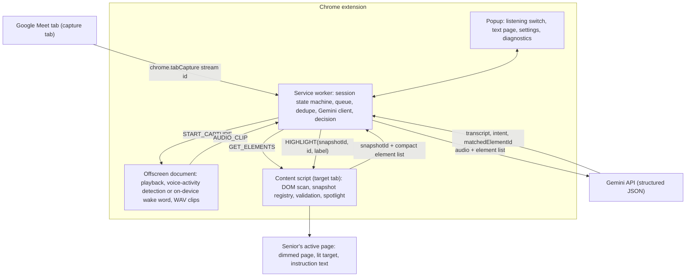

# Ollie

A Chrome extension (Manifest V3) that helps an older adult find things on a web page while a family member guides them over **Google Meet**. When the family member says *"Mom, click the Compose button on the left"*, the page on Mom's screen dims except for that button, which stays lit, with a short instruction beside it.

- Works on ordinary websites (Gmail, Meet, Wikipedia, shops, news…), subject to Chrome's restrictions.
- **Never clicks, types or submits anything.** It only points.
- Near-zero cost: no backend, no database. Typed commands work offline with no API key. Voice uses your own Gemini API key (free tier available).
- The family member installs nothing.

## Contents

1. [Project status](#project-status)
2. [Install the extension](#1-install-the-extension)
3. [Run the automated tests](#2-run-the-automated-tests)
4. [Test the app by hand: typed commands, no key](#3-test-the-app-by-hand-typed-commands-no-key)
5. [Test voice in a real Google Meet call](#4-test-voice-in-a-real-google-meet-call)
6. [Development workflow](#development-workflow)
7. [Where is the API key stored?](#where-is-the-api-key-stored)
8. [How it works](#how-it-works) · [Spotlight module](#spotlight-module) · [Project layout](#project-layout) · [Configuration](#configuration)
9. [Privacy and security](#privacy-and-security) · [Troubleshooting](#troubleshooting) · [Known limitations](#known-limitations) · [Roadmap](#roadmap)

## Project status

| Area | Status |
|---|---|
| Typed commands (offline matcher), pointer, DOM scanning | ✅ Verified in real Chrome, including live Wikipedia and example.com |
| Snapshot validation, privacy filters, no-click guarantee | ✅ Verified in real Chrome (integration tests) |
| Voice pipeline logic (dedupe, stale results, rate limits) | ✅ Verified in real Chrome with a **mocked** Gemini |
| Trigger word "Hey Jarvis" (on-device) and *Always listen* mode | ✅ Both verified in real Chrome by playing speech through the offscreen capture path; trigger word confirmed by hand in a real Meet call |
| Meet tab audio capture + real Gemini audio understanding | ⚠️ **Not yet verified in a real call.** Section 4 / [docs/TESTING.md](docs/TESTING.md) |
| Speech-to-pointer latency | ⚠️ Not measured yet. Recorded live in popup → Diagnostics |

---

## 1. Install the extension

**You need:** Google Chrome **116 or newer** (`chrome://version`).

1. Get the code:
   ```
   git clone https://github.com/yasamanparhizkar/build-north-2026.git
   cd build-north-2026
   git checkout dev
   ```
   (Or use your existing folder, e.g. `Z:\senior-helper-extension`.)
2. Open `chrome://extensions` and switch on **Developer mode** (top right).
3. Click **Load unpacked** and select the folder that contains `manifest.json`.
4. Click the puzzle icon in the toolbar and pin **Ollie** (the extension's name in `manifest.json`).
5. *(Voice only)* Get a free key at <https://aistudio.google.com> → *Get API key*. Then open the extension popup → **Settings**, paste the key, and click **Save**.

✅ **Check:** the extension card shows no red *Errors* button, and clicking the icon opens a popup with a listening switch and the status **Not listening** (or **Not on a Meet tab** if the active tab is not Google Meet).

**After every code change** (or `git pull`), click **↻ reload** on the extension card in `chrome://extensions`, then reload the web pages you test on.

---

## 2. Run the automated tests

### Prerequisites
- **Node.js 20+** and **Git**. Check with `node --version`.
  - Windows: `winget install OpenJS.NodeJS.LTS` (or the installer from <https://nodejs.org>). Then open a new terminal.
  - If PowerShell says *"running scripts is disabled"* for `npm`, use `npm.cmd` instead of `npm`, or run once: `Set-ExecutionPolicy -Scope CurrentUser RemoteSigned`.

### Steps
```
npm install                # once: dev tools (Puppeteer) and the ONNX runtime. Puppeteer downloads "Chrome for Testing" (~150 MB)
npm test                   # 124 unit tests incl. the manifest check, a few seconds
npm run test:integration   # 51 tests that load the real extension in Chrome for Testing, about a minute
npm run test:all           # both of the above
```
Chrome for Testing is stored in `%USERPROFILE%\.cache\puppeteer` (macOS/Linux: `~/.cache/puppeteer`). Your normal Chrome profile is not touched.

### Expected output
`npm test` ends with:
```
# tests 124
# pass 124
# fail 0
```
`npm run test:integration` ends with:
```
# tests 51
# pass 51
# fail 0
```

- **Network:** the three real-site tests (Wikipedia twice, example.com) need internet. They are *skipped*, not failed, if a site is unreachable.
- **Screenshots** go to `test/integration/screenshots/` (git-ignored). Set the `SCREENSHOT_DIR` environment variable to change this.
- **No API key is needed.** The voice tests replace Gemini with a fake inside the test browser.

### What the suites cover

| Suite | Covers |
|---|---|
| Unit (`test/*.test.js`, 13 files) | Audio resampling and WAV encoding, voice-activity detection and clip segmentation, wake-word features and gate, prompt and schema, response validation (made-up ids, unsupported actions, malformed JSON), Gemini client (model selection, fallback, 429, 5xx, timeout), matcher and synonyms, ambiguity handling, session state machine, stale-result rejection, dedupe, metrics, snapshot registry, URL filter, manifest |
| Integration (`test/integration/`) | Content-script injection and re-injection, DOM scan (shadow DOM, same-origin iframes, privacy: field values never collected), snapshot validation and re-matching, pointer tracking, the spotlight (lit target, dimmed page, scroll and resize, stacking, reduced motion, Stop clickable), the driver.js mode, **no clicks by the extension**, the on-device wake word under the extension's CSP, wake-word and always-listen end to end with a fake Gemini, the popup (listening switch, Settings, Forget key, text page), restricted pages, voice pipeline (dedupe, overload fallback, rate limit, Stop discards late results, metrics), and the real Wikipedia and example.com pages |
| Manual (sections 3–4, [docs/TESTING.md](docs/TESTING.md)) | Real Gmail/Meet pages, real tab audio capture, real Gemini, latency |

---

## 3. Test the app by hand: typed commands, no key

These checks use the popup's **Text** page. No API key and no Meet call are needed. Open each page, click the extension icon, click **Text**, type the command, and press **Enter**.

| # | Page | Type | Expected result |
|---|---|---|---|
| 1 | <https://en.wikipedia.org> | `where is log in` | The page dims and **Log in** (top right) stays bright, with the text "Click Log in" beside it. The popup shows no message on success |
| 2 | Same | `click in the search box` | Spotlight on the **Search Wikipedia** box |
| 3 | Same | `click the print button` | No spotlight. Badge: *"I couldn't find "click the print button" on this page."* The popup says *"Couldn't find that on this page."* |
| 4 | Same | (wait 20 s after #1) | The spotlight disappears by itself |
| 5 | Same | `where is log in`, then press **Escape** or the **×** next to the instruction | The spotlight disappears immediately |
| 6 | Same | `where is log in`, then scroll the page | The spotlight stays attached to the link |
| 7 | <https://mail.google.com> (signed in) | `click compose` | Spotlight on **Compose** (top left) |
| 8 | Gmail | `where is the search box` | Spotlight on **Search mail** |
| 9 | Gmail | `click settings` | Spotlight on the gear icon (an icon-only button) |
| 10 | <https://meet.google.com> (in a call) | `where is the mic button` | Spotlight on the microphone button |
| 11 | `chrome://extensions` | `click compose` | Popup: *"Chrome does not allow the helper on this page…"* |

**Safety check:** during all of the above, nothing should ever be clicked, typed or submitted by the extension.

---

## 4. Test voice in a real Google Meet call

**You need:** a saved Gemini API key (section 1, step 5), one **computer** with the extension (the *senior* side) and one **phone or second computer** (the *family member*). The family member side needs nothing installed. Use headphones on the senior computer so the family member's voice isn't picked up twice.

### Quick voice test (about 5 minutes)

1. **Computer:** open <https://meet.google.com>, click **New meeting** → *Start an instant meeting*, and copy the link.
2. **Phone:** join the same meeting with the link (any Google account, or as a guest).
3. **Computer, on the Meet tab:** click the extension icon and turn on the **listening switch**.
   ✅ The toolbar badge shows a green **ON**. The popup shows **Listening** (or **Say "Hey Jarvis"** in trigger word mode), and a pill appears top right with the same text and a **Stop** button.
4. **Phone:** say something. ✅ You still hear it clearly on the computer (no silence, no echo).
5. **Computer:** open a new tab with <https://en.wikipedia.org> (or Gmail) and stay on it.
6. **Phone:** say clearly: *"Click the Log in button."* (on Gmail: *"Click the Compose button."*)
   ✅ Within a few seconds the page dims and the control is lit.
7. **Phone:** chat normally for 30 s (*"How was your day?"*). ✅ No spotlight appears.
8. **Phone:** say *"Click the print button."* ✅ Badge: *"I couldn't find…"*, no spotlight.
9. **Computer:** open the popup → **Diagnostics**. Write down *Median Gemini* and *Speech → pointer*.
10. **Computer:** click **Stop** on the pill. ✅ The badge clears, the pill disappears, and Meet audio keeps playing normally.

If any step fails, see [Troubleshooting](#troubleshooting). For the full procedure (dropdown menus, duplicates, closing the Meet tab, extension restart) and a results log, use **[docs/TESTING.md](docs/TESTING.md)**.

### Where to look while testing
- **Service worker log:** `chrome://extensions` → the extension card → *service worker* link → Console.
- **Audio capture log:** same card → *Inspect views: src/offscreen/offscreen.html* (only shown while listening).
- **Page side:** DevTools on the page → Console (content-script warnings start with `[Senior Helper]`).

---

## Development workflow

### Branches
- `main`: stable, demo-ready.
- `dev`: integration branch. All work lands here first.
- Feature work: `git checkout dev && git pull && git checkout -b feature/<short-name>`. Open a pull request into `dev`.
- Merge `dev` → `main` only after `npm run test:all` passes **and** the quick voice test (section 4) passes.

### Everyday loop
1. Edit code in `src/`.
2. `npm test` (fast, pure logic).
3. `chrome://extensions` → **↻ reload** the extension → reload the test page.
4. Try it by hand (section 3, or section 4 for voice changes).
5. `npm run test:all` before pushing.
6. Commit with a clear message and push: `git push origin <branch>`.

### Common changes
- **Add a voice synonym** (e.g. "bin" → "trash"): edit `SYNONYMS` in `src/background/matcher.js` and add a case to `test/matcher.test.js`.
- **Tune speed vs. accuracy:** edit the constants in `src/shared/constants.js` (see [Configuration](#configuration)).
- **New message type:** add it to `src/shared/messages.js`. If a content script or the offscreen document sends it, update `CONTENT_ALLOWED` / `OFFSCREEN_ONLY`.
- **Driver.js (third-party, MIT):** installed with npm and copied into `src/vendor/driver.js/` (Manifest V3 forbids loading code from the internet). After updating the package run `npm run vendor` and commit the copied files. Its CSS is added to the page only when Driver.js mode is used.
- **ONNX Runtime Web:** copied into `vendor/onnxruntime-web/` by `npm run vendor:ort`.
- **No build step:** plain ES modules. Content scripts load through `loader.js` → dynamic `import()`, which is why `src/content/*.js`, `src/content/spotlight/*.js` and `src/shared/*.js` are listed as web-accessible.

### Before a pull request
- [ ] `npm run test:all` is green.
- [ ] Section 3 checks 1–6 pass by hand.
- [ ] For voice/audio changes: section 4 quick voice test passes.
- [ ] No API key, transcript or recording added to the repo (`git diff --cached` before committing).

---

## Where is the API key stored?

**Only in your Chrome profile, never in this repository.**

| Question | Answer |
|---|---|
| Where is it saved? | `chrome.storage.local` of this extension, inside your Chrome profile folder on disk (e.g. `%LOCALAPPDATA%\Google\Chrome\User Data\Default\Local Extension Settings\<extension-id>\`). |
| Is it encrypted? | **No.** Anyone with access to your computer account or profile folder could read it. It is not a secure vault. |
| Is it in the code or git history? | **No.** The code reads it from storage at runtime. Never paste a key into a source file. |
| Who receives it? | Only Google's Gemini API, in the `x-goog-api-key` request header. |
| Is it logged or synced? | Not logged by the extension. `storage.local` is not synced to other devices. |
| Can web pages read it? | No. Content scripts never receive the key. It is used only in the service worker. |
| How do I remove it? | Popup → Settings → **Forget key**. Removing the extension also deletes it. |
| What about the tests? | The integration tests use fake keys in a throwaway Chrome for Testing profile. |

**Recommendations:** use your own key (free tier), restrict it in Google AI Studio / Cloud Console to the *Generative Language API*, click **Forget key** on shared computers, and never publish a build with a key in it. A public Chrome Web Store release would need a small backend that issues short-lived tokens instead.

---

## How it works



**Capture tab vs. target tab.** Audio always comes from the Meet tab where you turned the listening switch on. The pointer goes on whatever normal tab is active in the last focused window. Switching tabs never touches the capture.

**Listening modes** (set in Settings):
- **Always listen** (default): the offscreen document sends short clips of all speech.
- **Trigger word**: an on-device model listens for "Hey Jarvis". Nothing leaves the computer until it is heard; then only the request after it is sent.

**Flow for one spoken command (always listen):**
1. The offscreen document plays the Meet audio back (capture mutes the tab otherwise) and runs an energy-based voice-activity detector with an adaptive noise floor.
2. A clip is sent **~0.7 s after speech ends**, or every **4 s** during long speech. Each clip holds up to **6 s** of audio, so consecutive clips overlap by 2 s and a sentence crossing a boundary is heard whole. Silence is never sent.
3. The service worker drops stale work (old session, already-handled sequence, older than 15 s, rate-limited), asks the content script for a fresh **snapshot**, and sends the clip plus a compact element table (`[id, role, name, region, visible]`) to Gemini with a strict response schema.
4. The answer is validated: unknown ids and unsupported intents are rejected, and confidence is clamped. Then it is combined with the deterministic matcher:
   - A confident validated pick points directly.
   - A missing or low-confidence pick falls back to matching the spoken target locally.
   - If it is still ambiguous, up to 3 numbered candidates are shown instead of guessing.
5. Duplicate commands from overlapping clips are suppressed (same target within 10 s). Results that arrive after *Stop* or after a newer highlight are discarded.
6. The content script resolves `(snapshotId, id)` to the live element and checks it still exists, is visible, and still has the same accessible name. If the page re-rendered, it re-matches by role and name. Only then does it draw the spotlight.

**Trigger word mode** differs in steps 1–2: the on-device detector keeps the last 2 s of audio in memory. When "Hey Jarvis" is heard, a chime plays, the page shows "I'm listening… say what to find.", and **one clip** (the phrase plus the request, at most about 10 s) is sent. Wake-word requests are never deduplicated.

**Typed commands** use the same path, except the offline matcher is tried first and Gemini (text) is only asked if the matcher is unsure and a key is saved.

**Session states:** `idle → starting → listening ⇄ processing → interrupted / error → idle`. Every Start or Stop bumps a *generation* number, so work started under an older session is discarded.

## Spotlight module

`src/content/spotlight/` is an independent module. It has no Chrome-extension dependencies.

```js
import { showSpotlight, updateSpotlight, hideSpotlight, destroySpotlight } from './spotlight/index.js';

await showSpotlight(elementOrSelector, 'Click the Record button.', {
  padding: 16, radius: 14, feather: 8, opacity: 0.82,   // look
  scroll: true, timeoutMs: 20000, dismissOnActivate: true,
  extraTargets: [], reacquire: (i) => findAgain(), onClose: (reason) => {}
}); // -> { ok: true } or { ok: false, reason: 'missing' | 'hidden' | 'ambiguous' | 'invalid-selector' | ... }
```

| File | Responsibility |
|---|---|
| `tracker.js` | Follows targets every animation frame (page/container scroll, resize, transforms, fixed elements, same-origin iframes). Re-finds targets that a framework re-rendered (`reacquire`) and reports when they are lost |
| `renderer.js` | One SVG in the closed Shadow DOM: a dark dim with blurred (feathered), rounded openings and a soft warm-white glow. No `viewBox`, so SVG units equal CSS pixels |
| `typography.js` | Floating white instruction text (no box, bubble or arrow), placed below/above/right/left, kept on screen and off the target. A small × close button. Numbered markers for candidates |
| `geometry.js` | Pure placement math (unit tested) |
| `index.js` | Public API, lifecycle, Escape, click-to-dismiss, timeout and cleanup |

**Behaviour:** smooth-scrolls to the target first, then fades in over 300 ms. It ends after a real (`isTrusted`) click on the target, Escape, the ×, or the timeout (20 s). It never clicks or moves focus. Every visual has `pointer-events: none` except the × button. With `prefers-reduced-motion` there are no fades or smooth scrolling.

**Driver.js mode:** an alternative highlight built on the driver.js library (`src/vendor/driver.js/`). It is used for a single target only; multiple candidates always use the spotlight. The popup has no control for it. It is chosen by setting `pointerStyle` to `driver` in `chrome.storage.local`, which is meant for developers.

**Limitations:**
- **Cross-origin iframes:** not supported. The content script runs only in the top frame, and Chrome won't let it measure inside other origins.
- **Closed shadow roots and canvas UIs:** can't be targeted.
- **Restricted pages:** browser pages (`chrome://`, Chrome Web Store, PDF viewer) can't be used at all.
- **Top layer:** elements in the top layer (`<dialog>.showModal()`, fullscreen) render above the overlay.
- **Driver.js mode:** keeps a hard-edged cutout, because Driver.js draws its own overlay.

## Project layout

```
manifest.json
src/
  background/          service worker (type: module)
    index.js             message routing + sender validation, tab listeners, SW recovery
    capture.js           start/stop/interrupt capture, offscreen lifecycle, action badge
    pipeline.js          clip/text -> snapshot -> Gemini/matcher -> validated highlight
    decision.js          combine Gemini answer with matcher; ambiguity handling (pure)
    matcher.js           offline matcher: names, synonyms, roles, position (pure)
    gemini.js            REST client: schema, timeout, model selection and fallback, retries (fetch injectable)
    prompt.js            system prompt, schema, compact elements, response validation (pure)
    sessionState.js      state machine, stale checks, dedupe (pure)
    session.js           chrome.storage.session wrapper with a write lock
    metrics.js           latency/usage aggregation (pure)
    queue.js             in-order queue that keeps only the newest waiting job
    tabs.js              top-frame messaging, auto-injection, target-tab lookup
  offscreen/           audio capture document
    offscreen.js         tab stream -> playback + analysis branch -> clips or wake-word gate
    frame-forwarder.worklet.js  AudioWorklet: collects mono frames on the audio thread
    segmenter.js         EnergyVad + ClipSegmenter (pure)
    wakeGate.js          opens the gate after the wake phrase; collects one request (pure)
    wakeEngine.js        loads the wake-word detector and plays the chime
    audio.js             streaming resampler, WAV/PCM encoding (pure)
  wakeword/            on-device "Hey Jarvis" detector (openWakeWord models, ONNX Runtime Web)
    detector.js          runs the three models on 16 kHz audio
    features.js          audio -> features for the detector (pure)
  content/             top frame of http(s) pages
    loader.js            classic script that imports main.js once
    main.js              message handling
    elements.js          DOM scan incl. open shadow roots + same-origin iframes
    accname.js           role + accessible name (never reads field values)
    describe.js          region, normalization, candidate limiting (pure)
    snapshot.js          snapshot registry with WeakRefs (pure)
    validate.js          snapshot validation + re-matching
    pointer.js           spotlight or Driver.js pointer, follows layout, auto-expires
    driverPointer.js     Driver.js highlight (alternative style)
    badge.js             status badge + listening pill with Stop button
    overlay.js / styles.js  closed Shadow-DOM overlay host + CSS
    spotlight/           the spotlight module (see above)
  popup/               listening switch, text page, settings, diagnostics
  shared/              constants, message names, URL helpers
  vendor/driver.js/    driver.js library copied in (MIT)
models/wakeword/       openWakeWord model files (see models/wakeword/README.md)
vendor/onnxruntime-web/  ONNX Runtime Web copied in
test/                  unit tests (node:test)
test/integration/      real-Chrome tests (Puppeteer + Chrome for Testing)
test/fixtures/         local test pages and audio clips
docs/TESTING.md        full manual procedure for a real Meet call + results log
```

Modules marked *pure* have no Chrome or DOM dependencies and are unit tested in Node.

## Configuration

**Popup → Settings**

| Setting | Default | Notes |
|---|---|---|
| Gemini API key | – | Required for voice only. See [Where is the API key stored?](#where-is-the-api-key-stored) |
| Listening mode | Always listen | *Trigger word*: nothing is sent until someone on the call says "Hey Jarvis"; then only that request is sent. *Always listen*: every sentence is sent. Takes effect the next time listening starts |
| Model | `gemini-flash-lite-latest` | Blank uses the default. If the chosen model is overloaded (5xx), silent for 8 s, or not found, `BUSY_FALLBACK_MODELS` are tried. If the model is not found, a Flash model from the account's model list is saved here. Run `node scripts/gemini-check.mjs` to measure models with your key |

**Tuning constants** in [src/shared/constants.js](src/shared/constants.js):

| Constant | Default | Effect |
|---|---|---|
| `DEFAULT_VOICE_MODE` | `VOICE_MODES.ALWAYS` | Listening mode for new installs |
| `DEFAULT_MODEL` | `gemini-flash-lite-latest` | Model used when the Model field is blank |
| `END_OF_SPEECH_MS` | 700 | Silence that ends an utterance. Lower means faster but may cut sentences |
| `CLIP_WINDOW_MS` / `CLIP_HOP_MS` | 6000 / 4000 | Clip length and interval during long speech (2 s overlap) |
| `MIN_SPEECH_MS` | 250 | Shorter sounds (coughs, clicks) are not sent |
| `MAX_CLIP_AGE_MS` | 15000 | Older clips are dropped as stale |
| `DEDUPE_WINDOW_MS` | 10000 | The same command within this window is ignored (always-listen clips only) |
| `GEMINI_ATTEMPT_TIMEOUT_MS` / `GEMINI_TIMEOUT_MS` | 8000 / 20000 | Wait per model before trying the next / wait in total |
| `WAKE_PHRASE` / `WAKE_MODEL_FILE` | "Hey Jarvis" / `hey_jarvis_v0.1.onnx` | Change both together (see [models/wakeword/README.md](models/wakeword/README.md)) |
| `WAKE_THRESHOLD` | 0.5 | Higher means fewer false alarms but more missed wake phrases |
| `WAKE_PREROLL_MS` / `WAKE_END_OF_COMMAND_MS` | 2000 / 900 | Audio kept before the wake phrase / pause that ends a request |
| `WAKE_WAIT_FOR_COMMAND_MS` / `WAKE_MAX_COMMAND_MS` | 5000 / 8000 | Give up with no request / hard limit on audio sent per wake phrase |
| `WAKE_CHIME` | `true` | Play a short tone when the wake phrase is heard |
| `MAX_ELEMENTS` / `MAX_SAME_NAME` | 180 / 4 | Prompt size limits |
| `HIGHLIGHT_TIMEOUT_MS` | 20000 | Pointer lifetime |

## Privacy and security

- Capture starts only when you turn on the listening switch. A badge and an on-page pill show it is active, and Stop is one click away.
- **Trigger word mode:** the Meet audio is checked on the computer by an on-device model ([openWakeWord](https://github.com/dscripka/openWakeWord) on ONNX Runtime Web). Only the last 2 s are held in memory, and nothing is sent until "Hey Jarvis" is heard. Then **one clip** (the phrase plus the request, at most about 10 s) is sent. A chime and an on-page message show when this happens.
- **Always listen mode (default):** **short clips of all speech** in the Meet tab's audio are sent.
- In both modes, the clip and the **names/roles of visible buttons and links** on your current page are sent to Google's Gemini API. They are subject to your API tier's data-use terms (free-tier data may be used by Google to improve products).
- Never sent: page HTML, field values, passwords, typed text, message bodies, cookies. Labels are truncated to 60 characters. Note that link text (for example an email subject shown as a link) can appear among the labels.
- No audio or transcripts are written to disk. The last transcript is kept only in memory (`chrome.storage.session`) for context and is cleared on Stop.
- Page text is treated as untrusted data: it is JSON-encoded in the prompt, the model's output is schema-validated, and returned ids must be in the submitted list. Nothing the model returns is executed or used as a selector.
- Web pages cannot drive the extension: messages are checked by sender type, and content scripts may only send *Stop*.
- `web_accessible_resources` exposes the content-script modules (needed to load ES modules), so a web page can detect that the extension is installed.

## Troubleshooting

| Symptom | What to check |
|---|---|
| **Meet audio not captured** | Turn on the listening switch in the popup *while the Meet tab is active* (Chrome requires the extension to be invoked on that tab). Look at the popup state line. Check the service worker console. A tab already captured by another extension cannot be captured twice. |
| **Meet audio becomes silent** | The offscreen document plays the audio back. Check *Inspect views: offscreen.html* → Console. Turn the switch off and on again. If the Meet tab was reloaded, capture ends (state: *interrupted*). |
| **Gemini errors** | The popup shows the message. `API key rejected` means re-paste the key. `Rate limit` means the helper pauses automatically. `Model not found` means it switches to an available Flash model (saved in Settings), or you can enter a model manually. |
| **Trigger word does not respond** | Check that the popup says *Say "Hey Jarvis"*. Speak the phrase clearly on the Meet call, and wait for the chime. The wake-word model is a bundled file: if the service worker or offscreen console shows a load error, reload the extension. |
| **No matching element** | Use the popup's Text page to check the page has a control with that label. Icon-only buttons need an `aria-label`/`title`. Cross-origin iframes and canvas-drawn controls are not supported. |
| **Not running on a page** | Content scripts don't run on `chrome://`, the Chrome Web Store, the PDF viewer or `file://` pages. Tabs opened before installing are injected automatically on first use. |
| **Errors in `chrome://extensions` after reloading** | Reload the web pages you are testing on. A page that was open before the reload still runs the old content script. |
| **Service worker / offscreen errors** | `chrome://extensions` → reload the extension. After a service-worker restart, the session is reconciled: if the offscreen document is gone, the state becomes *interrupted*. |
| **Pointer on the wrong tab** | The pointer goes to the active tab of the *last focused* Chrome window. Click into the window the senior is looking at. |
| **`npm` blocked in PowerShell** | Use `npm.cmd …` or `Set-ExecutionPolicy -Scope CurrentUser RemoteSigned`. |
| **Integration tests can't find Chrome** | Run `npm install` again (it downloads Chrome for Testing), or `npx puppeteer browsers install chrome`. npm may skip Puppeteer's install script; `npm install-scripts approve puppeteer` allows it. |
| **Popup diagnostics** | *Diagnostics* shows the last heard text, median Gemini / match / speech-to-pointer latency, API calls per minute and error rate, and clip and audio counts. |

## Known limitations

- Speech-to-pointer latency is expected to be roughly 0.7 s (end of speech) + upload + Gemini time; measure it with Diagnostics during a real call.
- Captured audio is the whole Meet tab playback, including the senior's own voice if Meet echoes it, and any shared media. Gemini decides what is an instruction.
- Cross-origin iframes, closed shadow roots, canvas UIs and native browser dialogs are not scanned.
- Elements in the browser's top layer (`<dialog>.showModal()`, fullscreen) can cover the overlay.
- The trigger word only hears the **Meet tab** (the other person's voice), not this computer's microphone.
- "Hey Jarvis" is openWakeWord's pre-trained model, licensed **CC BY-NC-SA 4.0 (non-commercial)**. A custom phrase needs a model trained with openWakeWord's notebook ([models/wakeword/README.md](models/wakeword/README.md)).

## Roadmap

1. Run the real-call procedure and record accuracy and latency (target: ≥ 90% correct on 20–30 commands, zero unintended clicks).
2. Tune `END_OF_SPEECH_MS`, or switch to streaming transcription if latency is too high.
3. Support cross-origin iframes through per-frame content scripts.
4. Move voice-activity detection and resampling into the AudioWorklet. It currently only forwards frames to the page.
5. Multilingual commands.
6. Chrome Web Store release with a token-issuing backend instead of a user-supplied key.
